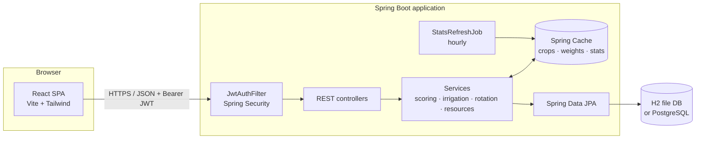
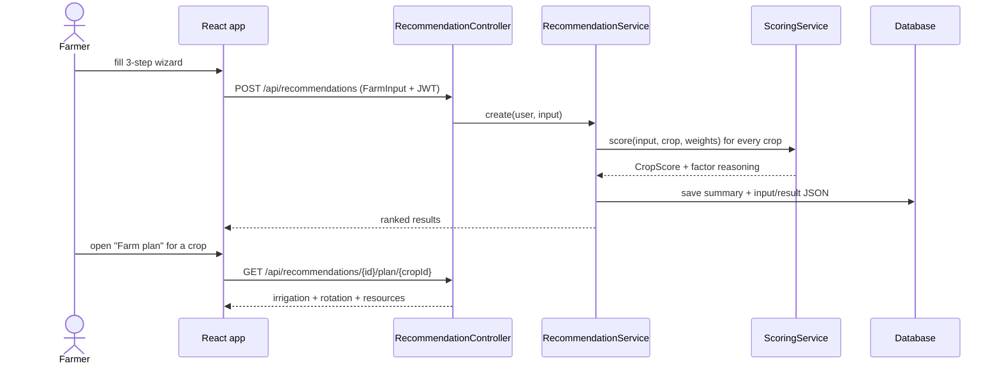
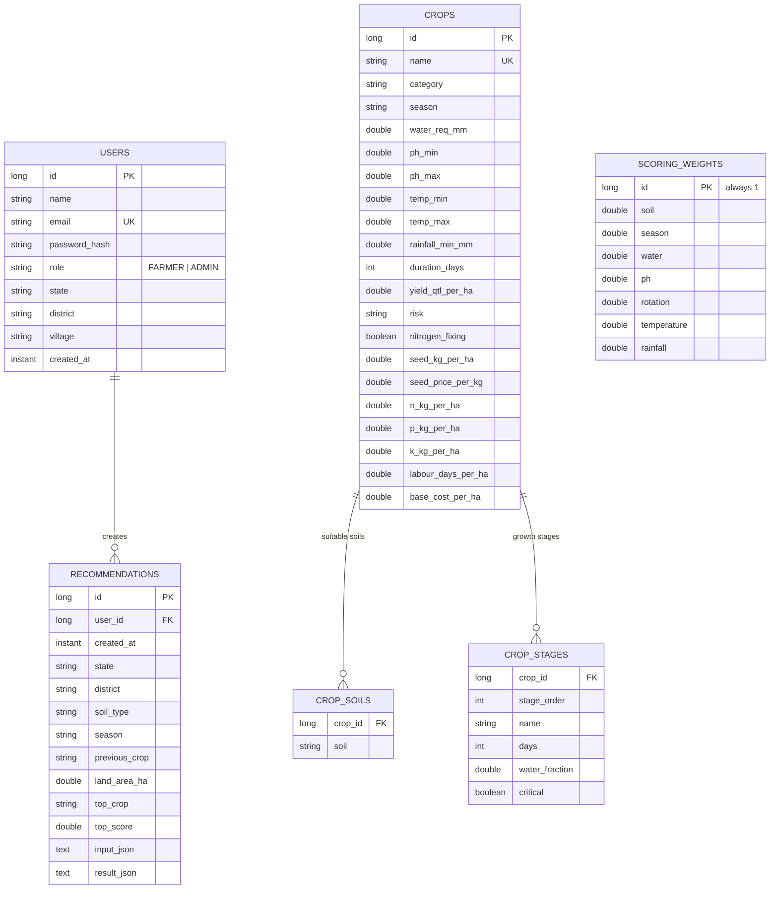

# Smart Crop Advisory & Resource Planner — Project Documentation

**Course:** Full Stack Development-II (FSD-II) · **Program:** B.Tech CSE (AI & ML) · **University:** Chandigarh University
**Stack:** React 18 + Vite + Tailwind CSS 4 (frontend) · Spring Boot 3.3 + Spring Security + JPA (backend)

---

## Table of contents

1. [Introduction](#1-introduction)
2. [Objectives and scope](#2-objectives-and-scope)
3. [System architecture](#3-system-architecture)
4. [Technology stack](#4-technology-stack)
5. [Backend design](#5-backend-design)
6. [Data model](#6-data-model)
7. [Recommendation scoring engine](#7-recommendation-scoring-engine)
8. [Irrigation, rotation and resource planners](#8-irrigation-rotation-and-resource-planners)
9. [REST API reference](#9-rest-api-reference)
10. [Security](#10-security)
11. [Frontend design](#11-frontend-design)
12. [Setup and running](#12-setup-and-running)
13. [Configuration](#13-configuration)
14. [Testing](#14-testing)
15. [Deployment](#15-deployment)
16. [Mapping to the project synopsis](#16-mapping-to-the-project-synopsis)
17. [Known limitations](#17-known-limitations)
18. [Future scope](#18-future-scope)

---

## 1. Introduction

Farmers usually decide what to plant using fragmented information about soil, pH, season, water, previous crops, rainfall, temperature and expected costs. Looking at only one factor (for example season) can hide water constraints, pH problems or rotation penalties.

**Smart Crop Advisory & Resource Planner** brings these factors into a single workflow. The user describes the farm; a deterministic, weighted scoring engine ranks every crop in the database and *explains* each score factor by factor. For a chosen crop the system then produces a farm plan covering irrigation, rotation and resource/cost estimates, and keeps a history of every recommendation.

The recommendation logic is **rule-based and transparent** — it is not a trained machine-learning model. ML-based yield prediction is listed under [Future scope](#18-future-scope).

## 2. Objectives and scope

| # | Objective | Where it is implemented |
|---|-----------|-------------------------|
| 1 | Centralised crop advisory & resource planning web app | whole system |
| 2 | Secure authentication with farmer/admin roles | `security/`, `AuthService`, `SecurityConfig` |
| 3 | Collect farm information | `Recommend.jsx` wizard, `FarmInput` DTO |
| 4 | Explainable weighted scoring | `ScoringService` |
| 5 | Factor-wise reasoning and suitability labels | `FactorScore`, `CropScore`, `Results.jsx` |
| 6 | Compare crops | `CompareTable` in `Results.jsx` |
| 7 | Stage-wise irrigation schedule & water balance | `IrrigationService`, `FarmPlan.jsx` |
| 8 | Crop-rotation recommendations | `RotationService` |
| 9 | Seed / fertilizer / labour / water / cost / yield estimates | `ResourceService` |
| 10 | Recommendation history | `RecommendationRecord`, `History.jsx` |
| 11 | Admin: crop CRUD, weights, statistics | `AdminController`, `CropController`, `Admin.jsx` |
| 12 | Caching with graceful behaviour | Spring Cache (`@Cacheable`/`@CacheEvict`) |
| 13 | Demo mode without external services | file-based H2 + JSON seed data |
| 14 | Responsive UI | Tailwind CSS utility layout |

**Out of scope (see future scope):** live weather, ML models, market prices, SMS, satellite imagery, multilingual UI, mobile app.

## 3. System architecture



**Request flow for a recommendation**



The frontend and backend are separate deployables. In development Vite proxies `/api` to `localhost:8080`; in production serve both behind one origin (reverse proxy) or set `VITE_API_URL` and the backend CORS origins.

## 4. Technology stack

| Layer | Technologies |
|-------|--------------|
| Frontend | React 18, Vite 5, Tailwind CSS 4, React Router 6, Recharts, Lucide React, Axios |
| Backend | Java 17, Spring Boot 3.3.5, Spring Web MVC |
| Security | Spring Security 6, JWT (jjwt 0.12.6), BCrypt |
| Persistence | Spring Data JPA / Hibernate; H2 (default) or PostgreSQL |
| Validation | Jakarta Bean Validation (`@Valid`) |
| Caching | Spring Cache (in-memory `ConcurrentMapCache`) |
| Scheduling | Spring `@Scheduled` |
| Testing | JUnit 5, Mockito, Spring Boot Test |
| Build | Maven (backend), npm (frontend) |

## 5. Backend design

Package `com.smartcrop`:

| Package | Responsibility |
|---------|----------------|
| `config` | `AppProperties` (typed `app.*` settings), `DataSeeder` (crops, default weights, admin user) |
| `security` | `JwtService`, `JwtAuthFilter`, `CustomUserDetailsService`, `SecurityConfig` (rules, CORS, password encoder) |
| `model` | JPA entities (`AppUser`, `Crop`, `CropStage`, `ScoringWeights`, `RecommendationRecord`) and enums |
| `repository` | Spring Data interfaces, incl. aggregate queries for admin statistics |
| `dto` | Java `record` request/response types grouped by area (`AuthDtos`, `RecommendationDtos`, `PlanDtos`, `AdminDtos`) |
| `service` | Business logic (see below) |
| `controller` | Thin REST controllers |
| `exception` | `ApiExceptions` + `GlobalExceptionHandler` mapping errors to JSON with proper HTTP codes |

Key services:

- **`ScoringService`** — scores one crop for one farm (seven factors → weighted total, label, warnings).
- **`RecommendationService`** — scores all crops, ranks them, persists the run, serves history.
- **`IrrigationService`** — water requirement, stage schedule, water balance.
- **`RotationService`** — compatibility rules, next-season options, three-season sequence.
- **`ResourceService`** — seeds, fertilizer, labour, water cost, total cost and yield.
- **`FarmPlanService`** — combines the three planners for one recommendation + crop.
- **`CropService` / `WeightsService`** — cached data access; evict caches on admin changes.
- **`AdminService`** — cached aggregate statistics.
- **`ReferenceDataService`** — 7 soils, 5 irrigation methods, 15 regions, water levels.

Responses are built from immutable records; recommendations are stored as summary columns (for queries and statistics) plus the full input/result JSON (so a past result can be re-opened exactly as it was computed, even if crop data or weights later change).

## 6. Data model



Schema is generated by Hibernate (`ddl-auto: update`). For production use a migration tool (Flyway/Liquibase) and `validate`.

### Seed dataset

`backend/src/main/resources/data/crops.json` contains **14 crops** (wheat, rice, maize, cotton, sugarcane, mustard, chickpea, soybean, potato, tomato, groundnut, bajra, onion, green gram). `ReferenceDataService` provides **7 soil types**, **5 irrigation methods** (flood 50 %, furrow 60 %, check basin 55 %, sprinkler 75 %, drip 90 % efficiency) and **15 regions** across Indian states. Crops are loaded on first start only if absent, so admin edits are never overwritten.

Each crop has default four-stage water profile (Establishment 15 %, Vegetative 30 %, Flowering/grain-filling 35 % — *critical*, Maturity 20 %) with stage lengths proportional to the crop duration.

## 7. Recommendation scoring engine

For every crop the engine computes seven factor scores on a 0–100 scale and combines them:

```
final score = Σ ( weightᵢ × scoreᵢ ) / Σ weightᵢ
```

Default weights (editable by an admin, applied immediately; they are relative so they need not sum to 100):

| Factor | Weight | Score rule (0–100) |
|--------|-------:|-------------------|
| Soil type | 25 % | 100 if the farm soil is in the crop's suitable soils, else 25 |
| Season | 20 % | 100 same season · 85 year-round crop · 20 otherwise |
| Water | 20 % | `min(100, 100 × supply / need)` where `supply = water level (mm) × irrigation efficiency` |
| Soil pH | 10 % | 100 inside the optimal range, minus 45 per pH unit outside it (floor 0) |
| Crop rotation | 10 % | see [rotation rules](#rotation-rules) |
| Temperature | 10 % | 100 inside the range, minus 10 per °C outside it (floor 0) |
| Rainfall | 5 % | `min(100, 100 × seasonal rainfall / crop minimum rainfall)` |

Water levels map to seasonal irrigation water: **LOW 300 mm, MEDIUM 600 mm, HIGH 1000 mm**.

**Suitability labels:** ≥ 80 *Highly Suitable* · ≥ 65 *Suitable* · ≥ 50 *Moderately Suitable* · otherwise *Not Recommended*.

Each factor returns a human-readable **reasoning** sentence, and the crop gets a list of **warnings** (soil mismatch, outside season, water deficit, pH far from range, poor rotation, temperature far from range).

### Worked example

Farm: Punjab, **Alluvial** soil, pH 6.8, **HIGH** water, **Sprinkler** irrigation, **Rabi** season, no previous crop, 18 °C, 120 mm rainfall. Crop: **Wheat** (water 450 mm, pH 6.0–7.5, 12–25 °C, min rainfall 100 mm, soils Alluvial/Loamy).

| Factor | Calculation | Score | Weight |
|--------|-------------|------:|-------:|
| Soil | Alluvial is suitable | 100 | 25 |
| Season | Rabi = Rabi | 100 | 20 |
| Water | 1000 × 0.75 = 750 mm vs 450 mm → 167 % → capped | 100 | 20 |
| pH | 6.8 within 6.0–7.5 | 100 | 10 |
| Rotation | no previous crop → neutral | 75 | 10 |
| Temperature | 18 °C within 12–25 °C | 100 | 10 |
| Rainfall | 120 / 100 → capped | 100 | 5 |

`(25×100 + 20×100 + 20×100 + 10×100 + 10×75 + 10×100 + 5×100) / 100 = 97.5` → **Highly Suitable**. This case is covered by a unit test.

## 8. Irrigation, rotation and resource planners

### Irrigation (`IrrigationService`)

```
effective rain   = min(crop water need, 0.75 × seasonal rainfall)
net irrigation   = crop water need − effective rain
gross irrigation = net irrigation / method efficiency            (mm to apply at source)
volume (m³)     = gross irrigation × 10 × area (ha)              (1 mm over 1 ha = 10 m³)
stage water      = gross irrigation × stage water fraction
balance          = available water (mm) − gross irrigation        (>= 0 SURPLUS, < 0 DEFICIT)
```

The schedule lists each stage's day range, water (mm) and volume (m³); critical stages are flagged and produce warnings, as does a seasonal deficit.

### Rotation rules (`RotationService`)

`compatibility(previous crop → candidate)` returns a score and a sentence:

| Situation | Score |
|-----------|------:|
| No / unknown previous crop | 75 (neutral) |
| Same crop repeated | 20 |
| Previous crop fixes nitrogen and candidate does not | 100 |
| Same category | 40 |
| Candidate is a legume following a non-legume | 90 |
| Different category (diversification) | 80 |

The farm plan shows the selected crop's compatibility, the best **next-season** crops (Kharif → Rabi → Zaid → Kharif; year-round crops are not used as rotation successors), and a greedy **three-season sequence**.

### Resources (`ResourceService`)

```
seed (kg)      = seed rate × area                  seed cost = seed × seed price
DAP (kg)       = P required / 0.46                 (18-46-0)
Urea (kg)      = max(0, N required − 0.18×DAP) / 0.46   (46-0-0)
MOP (kg)       = K required / 0.60                 (0-0-60)
labour cost    = worker-days × daily wage
water cost     = volume (m³) × price per m³
total cost     = seed + fertilizer + labour + water + other cultivation cost
expected yield = yield per ha × area              cost per quintal = total cost / yield
```

Input prices (urea, DAP, MOP, wage, water) are configurable under `app.pricing` in `application.yml`.

## 9. REST API reference

Base URL: `http://localhost:8080/api`. All endpoints except register/login require `Authorization: Bearer <token>`.
Errors return `{ status, message, errors?, timestamp }` with status 400 (validation), 401, 404, 409 or 500.

### Authentication

| Method | Path | Access | Description |
|--------|------|--------|-------------|
| POST | `/auth/register` | public | Create a farmer account → `{ token, user }` (201) |
| POST | `/auth/login` | public | Log in → `{ token, user }` |
| GET | `/auth/me` | any user | Current user profile |

```json
POST /api/auth/register
{ "name": "Ravi Kumar", "email": "ravi@example.com", "password": "secret123",
  "state": "Punjab", "district": "Ludhiana", "village": "Jagraon" }
```

### Recommendations and plans

| Method | Path | Description |
|--------|------|-------------|
| POST | `/recommendations` | Score all crops for a farm; saves and returns the ranked result (201) |
| GET | `/recommendations` | Current user's history (newest first) |
| GET | `/recommendations/{id}` | One saved recommendation (owner or admin) |
| GET | `/recommendations/{id}/plan/{cropId}` | Farm plan: irrigation + rotation + resources |

```json
POST /api/recommendations
{ "state": "Punjab", "district": "Ludhiana", "landAreaHa": 2.0,
  "soilType": "Alluvial", "soilPh": 6.8,
  "waterAvailability": "HIGH", "irrigationMethod": "Sprinkler",
  "season": "RABI", "previousCrop": "Rice",
  "temperatureC": 18, "rainfallMm": 70 }
```

Validation: `landAreaHa > 0`, `soilPh` 3–10, `temperatureC` −5–55, `rainfallMm ≥ 0`, `season` ∈ KHARIF/RABI/ZAID, `waterAvailability` ∈ LOW/MEDIUM/HIGH, `irrigationMethod` must be one of the five known methods.

### Planning utilities

| Method | Path | Description |
|--------|------|-------------|
| POST | `/irrigation/calculate` | Irrigation plan for `{ cropId, farm }` without saving a recommendation |
| GET | `/rotation?previousCrop=&cropId=` | Rotation plan for growing `cropId` after `previousCrop` |
| GET | `/reference` | Soils, irrigation methods, regions, seasons, water levels |

### Crops

| Method | Path | Access | Description |
|--------|------|--------|-------------|
| GET | `/crops` | any user | List crops |
| GET | `/crops/{id}` | any user | One crop |
| POST | `/crops` | admin | Create (201); default stages generated if omitted |
| PUT | `/crops/{id}` | admin | Update |
| DELETE | `/crops/{id}` | admin | Delete (204) |

### Admin

| Method | Path | Description |
|--------|------|-------------|
| GET | `/admin/stats` | Users, recommendations, crops, popular crops, activity by state, latest runs |
| GET | `/admin/weights` | Current scoring weights |
| PUT | `/admin/weights` | Update weights (non-negative, at least one > 0) |

## 10. Security

- **Stateless JWT** (HS256). The token carries the e-mail as subject and the role as a claim; expiry is `app.jwt.expiration-ms` (24 h by default).
- **Passwords** are hashed with BCrypt; plain passwords are never stored or logged.
- **Authorization:** `/api/admin/**` and crop create/update/delete require `ROLE_ADMIN`; everything else except register/login requires authentication. Unauthenticated requests get **401**.
- **Ownership:** a farmer can only open their own recommendations and plans (others return 404); admins can open any.
- **Validation:** all inputs are validated with Bean Validation; malformed JSON returns 400.
- **CORS** is limited to the origins in `app.cors.allowed-origins`.
- **CSRF** is disabled because the API is stateless and uses bearer tokens (no cookies).
- The frontend keeps the token in `localStorage`; for higher-security deployments consider httpOnly cookies.

## 11. Frontend design

| Route | Page | Purpose |
|-------|------|---------|
| `/login`, `/register` | `Login`, `Register` | Authentication |
| `/` | `Dashboard` | Summary stats, quick start, recent runs |
| `/recommend` | `Recommend` | 3-step wizard with region pre-fill |
| `/results/:id` | `Results` | Ranked crops, expandable factor reasoning, warnings, compare up to 3 |
| `/plan/:id/:cropId` | `FarmPlan` | Irrigation chart/table, rotation sequence, resource & cost table |
| `/history` | `History` | Past recommendations |
| `/admin` | `Admin` | Statistics, crop CRUD, scoring weights (admin only) |

Implementation notes: `AuthContext` stores the session; `api.js` attaches the bearer token and redirects to `/login` on 401; `ProtectedRoute` guards pages (and the admin page by role); the layout is responsive with Tailwind and charts use Recharts.

## 12. Setup and running

**Prerequisites:** JDK 17+, Maven 3.9+, Node.js 18+.

```bash
# Backend
cd smart-crop-advisory/backend
mvn spring-boot:run              # http://localhost:8080

# Frontend (new terminal)
cd smart-crop-advisory/frontend
npm install
npm run dev                      # http://localhost:5173
```

On first start the backend creates the database in `backend/data/`, loads the 14 crops, writes the default weights and creates the admin account (`admin@smartcrop.local` / `Admin@123`).

**Using PostgreSQL instead of H2**

```bash
docker run -d --name smartcrop-db -e POSTGRES_DB=smartcrop -e POSTGRES_PASSWORD=postgres -p 5432:5432 postgres:16
DB_URL=jdbc:postgresql://localhost:5432/smartcrop DB_USER=postgres DB_PASSWORD=postgres \
  mvn spring-boot:run -Dspring-boot.run.profiles=postgres
```

**Production build**

```bash
cd backend  && mvn clean package          # target/smart-crop-advisory-1.0.0.jar
cd frontend && npm run build              # dist/ (static files)
```

## 13. Configuration

`backend/src/main/resources/application.yml`:

| Property | Default | Notes |
|----------|---------|-------|
| `server.port` | `8080` | |
| `spring.datasource.url` | file H2 in `./data` | override via `DB_URL` with the `postgres` profile |
| `app.jwt.secret` | dev placeholder | **set `JWT_SECRET`** (≥ 32 characters) in production |
| `app.jwt.expiration-ms` | `86400000` | 24 hours |
| `app.cors.allowed-origins` | `localhost:5173`, `localhost:3000` | add your deployed frontend URL |
| `app.admin.email` / `password` | `admin@smartcrop.local` / `Admin@123` | override with `ADMIN_EMAIL`, `ADMIN_PASSWORD` |
| `app.pricing.*` | indicative INR prices | urea, DAP, MOP per kg; labour per day; water per m³ |

Frontend: optional `VITE_API_URL` (defaults to `/api`).

## 14. Testing

```bash
cd backend && mvn test
```

- `ScoringServiceTest` (plain JUnit + Mockito): ideal conditions score ≥ 90 and *Highly Suitable* (the worked example above); wrong season/soil lowers the score and produces warnings; repeating the same crop gets a rotation score of 20.
- `SmartCropApplicationTests`: boots the whole application context against in-memory H2 and runs the data seeder.

Suggested manual checks: register a farmer → run a recommendation → open the farm plan → verify it appears in History; log in as admin → change a weight → re-run and confirm scores change; confirm a farmer gets 403/redirect on `/admin`.

## 15. Deployment

1. Build the backend jar and run `java -jar` with `JWT_SECRET`, `ADMIN_PASSWORD`, `SPRING_PROFILES_ACTIVE=postgres` and the DB variables set.
2. Build the frontend (`npm run build`) and serve `dist/` from any static host or Nginx.
3. Put both behind one domain with a reverse proxy that forwards `/api` to the backend (avoids CORS); otherwise set `VITE_API_URL` at build time and add the frontend origin to `app.cors.allowed-origins`.
4. Use HTTPS, rotate the JWT secret, and replace `ddl-auto: update` with a migration tool.

## 16. Mapping to the project synopsis

The synopsis describes a MERN-style implementation (Node/Express, MongoDB, Redis). This project delivers the same functionality on the **required React + Spring Boot** stack. Deliberate substitutions:

| Synopsis | This implementation | Reason |
|----------|--------------------|--------|
| Node.js + Express | Spring Boot 3 (Java 17) | Course requirement |
| MongoDB + Mongoose | JPA/Hibernate on H2 (default) or PostgreSQL | Relational model fits the structured data; zero-setup demo |
| Redis cache with fallback | Spring Cache (in-memory) | Same `@Cacheable` abstraction; a Redis cache manager can be plugged in without code changes |
| Demo mode (JSON, in-memory) | JSON seed + file-based H2 | App runs with no external services and data persists across restarts |
| bcryptjs, jsonwebtoken, express-validator | BCrypt, jjwt, Bean Validation | Spring equivalents |
| Jest | JUnit 5 + Mockito | Java testing standard |
| Timer-based background jobs | `@Scheduled` job | Spring equivalent |
| Seven weighted factors and weights | Unchanged (25/20/20/10/10/10/5) | |
| 14 crops, 7 soils, 15+ regions, 5 irrigation methods | Unchanged | |

## 17. Known limitations

- Data is focused on Indian agriculture and is **sample data**; it should be validated by agricultural experts.
- The engine is rule-based and deterministic, not machine-learning based.
- Weather values (temperature, rainfall) are entered/pre-filled, not fetched live.
- Cache is per-instance and in-memory; running several backend instances needs a shared cache (e.g. Redis).
- The scheduled job is a simple in-process timer, not a distributed job queue.
- Schema is auto-generated by Hibernate; no migration scripts yet.
- Seed crops are loaded once; deleting a crop does not remove it from already-stored recommendations (they keep their snapshot, but opening a plan for a deleted crop returns 404).

## 18. Future scope

- Live weather via a weather API.
- Machine-learning yield prediction trained on historical datasets.
- Market-price integration for profitability / ROI.
- Multilingual UI (Hindi, Tamil, Telugu, Punjabi).
- SMS irrigation and advisory reminders.
- Satellite / NDVI crop and soil-health analysis.
- Government scheme and subsidy information.
- Farmer community forum.
- React Native mobile app and offline PWA.
- Redis-backed cache and a proper job queue; Flyway migrations; Docker Compose for one-command startup.
